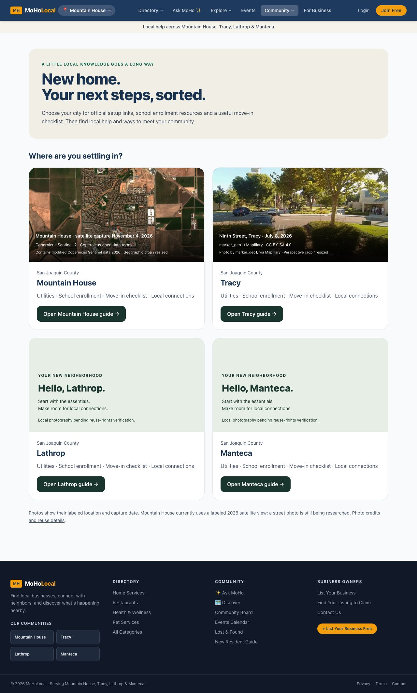

# New Resident Guide release — November 6, 2026

Application: deac43c2c31292f3029e179b27d107b2f42c0717.
Native Cloudflare build: 43db9bfa-e9b4-4c24-9e7d-282fafbc7986, Ready, 1m39s; version prefix fad66bdf.

## Changed

Four-city hub, reusable licensed-image presentation, official city utility and district resources, six-step interactive move-in checklist and city-preserving directory/events/classes/community/pet actions. Unsupported school ratings, drive-time claims, unaudited school lists and legacy embedded business rankings removed. No database dependency remains on guide routes. No business data deleted. Brentwood guide intentionally returns not found.

## Validation

- Exact committed release exported separately: 123 tests pass. Full working repository: 135 tests pass, including unreleased pet matching tests. TypeScript and OpenNext build pass.
- Production browser: hub and Mountain House, Tracy, Lathrop, Manteca guide headings and corrected provider sections checked.
- Production checklist: Mountain House 0→1 complete; Tracy opens at0, with city scoped navigation intact.
- Mountain House at320px and Tracy at390px: document width equals viewport width. Viewport restored afterward. This is browser viewport testing, not a physical phone acceptance claim.
- Brentwood displays explicit404. Direct terminal HTTP smoke was blocked403; browser acceptance used instead.
- Official destinations verified through primary-source web retrieval; Lathrop waste/new-resident pages additionally inspected in browser after retrieval restrictions. Linked county school finder and district registration/boundary resources provide the next step, not a guarantee of placement.

## Remaining

Lathrop/Manteca city photos require location/capture/reuse evidence. Mountain House uses the transparently labeled existing November4,2026 satellite asset until a licensed real2026 street photo is found. Tracy uses credited July8,2026 Ninth Street photography with CC BY-SA4.0 provenance. No new photo rights assumed.

Checklist progress resets on reload or city navigation and is explicitly described as page-local. Saved account checklist is a future enhancement. Legacy business duplicate/evidence audit remains DATA-02; guide links to the current directory instead of republishing its old selections. Photos, catalogue research and broader FB review remain open.

Resource URLs and reviewed information are maintained in lib/new-resident.ts. No resident addresses, school enrollment records or other private information are collected by the checklist.
