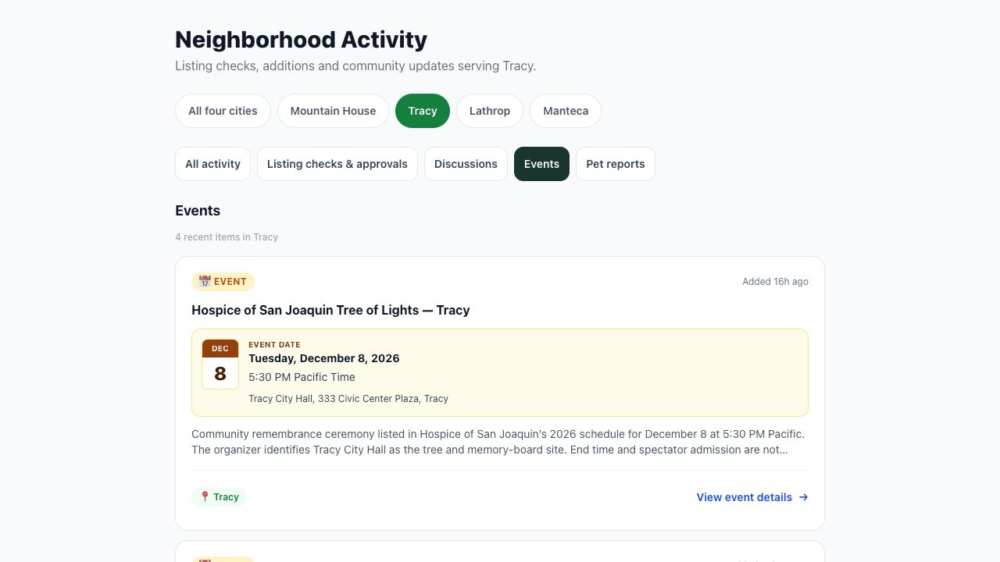

# Activity event previews — November 25, 2026

## Observed problem
Live Tracy event Activity cards showed publication age prominently while date/time/venue appeared only inside a two-line description. An older-added event can occur sooner than a newer-added event; residents need both timestamps distinguished without changing actual feed ordering.

## Change
Pass existing approved event start/end/location fields into cards. Add an amber calendar panel with Pacific occurrence date, supplied time range and venue. Unknown end remains unknown; invalid occurrence metadata omitted. Event publication label says Added. All cards gain an explicit next-action footer and visible keyboard-focus ring, with shorter accessible link names. Existing listing check/approval labels and real source records remain intact. No images, posts, engagement or event facts generated; no schema/data changes.

## Validation / release
219 regressions and TypeScript pass. Includes UTC-to-Pacific calendar boundary, supplied/unknown end time and invalid-date handling. OpenNext Cloudflare build passed. Local production browser accepted desktop visual hierarchy and all four city event streams at320x740 with no horizontal overflow (6/4/3/4 event previews in MH/Tracy/Lathrop/Manteca). Keyboard Enter opens Manteca event detail, whose Back to Events retains Manteca; Lathrop listing actions/check dates and320px width accepted. Browser emulation, not physical-device testing. Production acceptance COMPLETE: native build e2624797-380c-4daa-b9c5-10be0fe81567 Ready (1m59s), deployed version prefix66f2d45c. Public build-info source matches38e653bfa9dc35b08bf10ab7e313b1354c8a4ecf. All four production event streams accepted at measured320px without overflow; event preview counts6/4/3/4 match local. Manteca December1 5:30PM preview/keyboard detail/Back-to-Events city context accepted, including unknown end time. Lathrop listing check date Nov24 and explicit View listing action accepted.

## Constraints and stop condition
Retain Next.js/Cloudflare/Supabase. No pet feature expansion or pilot gate. FB unpublished, photo tasks open. Existing intermittent Activity backend-load failure not claimed fixed. Complete this focused batch after local mobile/desktop, native deployment/source marker and production event/detail checks; then return to core verified directory coverage.

Application source:38e653bfa9dc35b08bf10ab7e313b1354c8a4ecf. Native build:e2624797-380c-4daa-b9c5-10be0fe81567 Ready; production source/UI acceptance passed. Local server and disposable test Postgres stopped after validation.

This focused UI batch COMPLETE. No change to event facts, approval/check timestamps, feed sorting, database policy, permissions or media. Existing intermittent backend Activity error remains a separate observation, not claimed fixed.
