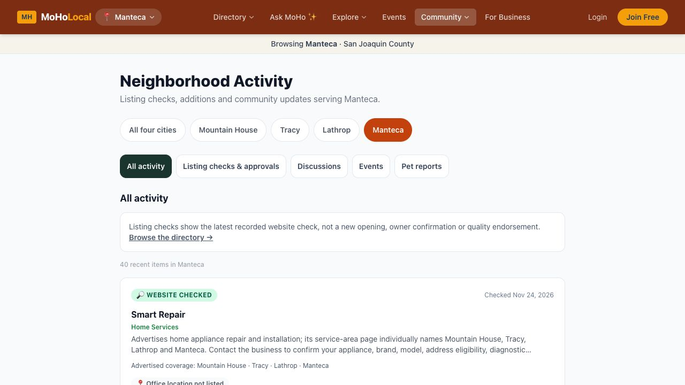

# November 24 overnight — service coverage and holiday source review

## Published editorial changes

Two distinct providers added, both with explicit first-party service-city evidence for Mountain House, Tracy, Lathrop and Manteca:

- Ron’s Pool and Spa Service (`b2cf2802-9e4d-4a7b-b50a-bd54fa28cd07`): [official services](https://www.ronspoolandspa.com/services), phone (209) 603-0694. Pool cleaning/maintenance/repair and spa maintenance. Fresh HTTP200 and named city list; no visitor office inferred.
- Smart Repair (`18df17a8-6ee0-4297-b5b8-fdf618b153f4`): [official service areas](https://smart-repair.us/service-areas/), [homepage](https://smart-repair.us/), phone (510) 283-8087. Appliance repair/installation; named cities and fresh HTTP200. [Appliance request page](https://smart-repair.us/booking/?service=appliance) reviewed as intake requiring confirmation, not an available appointment. No license/brand-affiliation/insurance claim adopted and no local storefront inferred.

Mountain Cleaners (`a598f456-4fe7-49b6-9f45-187ba1e33ccf`): [fresh primary homepage](https://mountain-cleaners.com/) HTTP200 confirms existing Mountain House trash-bin service and public (209) 321-0006. Added canonical `trash can cleaning` tag alongside original tags. Existing business approval/creation timestamp November 6 preserved. This is a corrected discovery gap, not a new provider or new geographic coverage.

| Exact checked service | Mountain House | Tracy | Lathrop | Manteca |
| --- | --- | --- | --- | --- |
| Appliance repair | 0 → 1 | 0 → 1 | 0 → 1 | 0 → 1 |
| Pool cleaning | 0 → 1 | 0 → 1 | 0 → 1 | 0 → 1 |
| Trash can cleaning | 1 → 2 | 3 unchanged | 3 unchanged | 3 unchanged |

Counts are service/city coverage among approved records with scoped checks, not total available supply, bookings, quality, credentials or owner-confirmed availability. Two unique new businesses serve overlapping cities; do not count eight businesses.

## Publication and acceptance

Deduplicated name/domain/normalized phone before publication; transaction repeats duplicate checks and asserts expected old Mountain Cleaners evidence. Saved private before/after correction history. SQL retained in `publish-pool-appliance-2026-11-24.sql` (already executed; do not rerun).

Anonymous Data API HTTP200 returns all three business/check records with expected contacts, tags and coverage. Read-back evidence retained privately in `.private-refresh/2026-11-24-pool-appliance-anonymous.json`; no credentials serialized. All four city Directory Newest, Discover and Activity views show both new providers. Mountain House bin shortlist now returns 2 including Mountain Cleaners. Both public provider detail call/website hrefs accepted without placing calls. Desktop and confirmed 320x740 browser searches for pool cleaning/appliance repair accepted in all four cities, no horizontal overflow. These are browser viewport checks, not physical-device tests.

One initial Mountain House Activity navigation timed out and rendered its error message; a single refresh recovered and showed all three actual checks. Later Tracy/Lathrop/Manteca Activity views accepted without that error. No cause established or reliability fix claimed; retain an observed-failure follow-up rather than guessing. Initial search viewport attempt remained 1280px on the inactive tab, so it was not counted as mobile acceptance; repeated on the active tab with measured320px, all8passed.

Data-only changes require no application build or redeployment. Existing live application remains 470d0707078afa67212cd7ca108ea5b6f81394c8 from the accepted November23 release.

## Holiday sources reviewed — no duplicate events or invented hours

Existing records retained; no artificial refresh dates or new event cards:

- [Mountain House MoHoHo](https://www.mountainhouseca.gov/277/MoHoHo-Holidays): freshHTTP200 still December5,2026 5PM parade; existing venue/schedule record retained. Page’s November20 entry deadline has passed; no new registration-open claim published.
- [Tracy holiday parade](https://www.cityoftracy.org/I-Want-To/View/City-Calendar/2026/Events-Folder/Holiday-Light-Parade-and-Tree-Lighting): fresh normal-browser reading after terminalHTTP403; December5 6–8:30PM downtown locations and street-closure notice match existing record.
- [Lathrop parade/tree lighting](https://www.ci.lathrop.ca.us/parksrec/page/christmas-parade-tree-lighting-0): freshHTTP200 confirms December5 5PM. Exact route/lighting venue/end/admission still not established by this page; retain existing explicit uncertainty, never copy department contact addresses as event venue.
- [Manteca Christmas in Park/Parade](https://manteca.org/2026-manteca-christmas-in-the-park-parade/): web source reviewed; already listed as `92459c3d-bebb-4a5a-aca7-29171c040af2`, not newly added. Park December5 noon–9PM,320WCenter; parade5PM onYosemite. Direct terminal fetch406; no fresh terminal-success claim.

No provider Thanksgiving operating hours or current appointment slots confirmed. Ordinary weekly hours do not establish November26 availability. No closure or blanket all-city library hours inferred from a different branch’s calendar.

## Held / remaining gaps

209 Bin Cleaners primary website states broad209coverage but not individually checked target-city service coverage; secondary city placement alone is insufficient. Valley Bin Cleaners Linktree advertises named cities but no independently established usable direct booking/contact route in this pass. Memo’s Pools web fetch failed; no closure conclusion. No provider from these leads published. Bounded sitter/walker discovery returned already checked providers and marketplace/secondary leads without newly established primary identity/contact/coverage; zero new sitters or walkers this pass. Lathrop/Manteca independent-supply work remains open.

Next: continue individually qualified service/event coverage, confirmed holiday notices and investigate Activity failure only with reproducible behavior/log evidence. FB remains UNPUBLISHED; no outreach/imports, copied private photos, posters, ratings or engagement. Photo date/location/reuse tasks OPEN. Pet reporting LIVE with ordinary QA/moderation; no pilot launch gate. This overnight increment does not complete the separate November24 9AM scheduled refresh.
