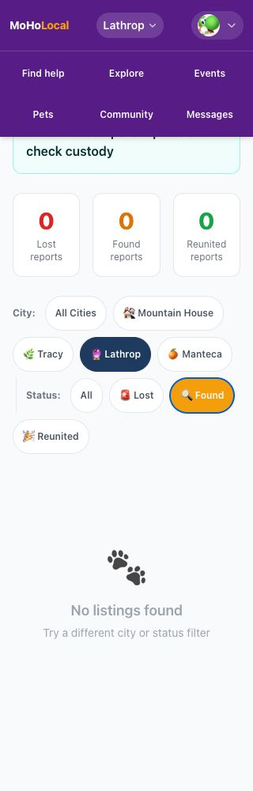

# Pet board SEO, mobile acceptance and bounded research — November 16, 2026

## November 16 — pet-board SEO and mobile filters (SEO-LOCAL-04 / MOBILE-20 / SUPPLY-21)

LIVE: default pet-board filter URLs canonicalize to the clean board; meaningful city/status/history views retain distinct metadata. Invalid/duplicate filters are noindex,follow. City/status controls and report CTA measure44px at320px, with no horizontal overflow. Keyboard Lathrop/found selection and separate Lathrop history canonical accepted; viewport restored.198tests, TypeScript and OpenNext pass. Native f7b7720e053566ba7b10af9bfcbdb7b2cd7e7a4b completed success and exact public build marker accepted. This fixes a sampled Search Console duplicate cohort; Google recrawl/resolution remains OPEN.

Additional PSI individual profiles reviewed: search-city inclusion does not establish operator travel coverage. All Wags Care lacks explicit target-city evidence; Camp Cardinale is Los Gatos facility boarding; other broad-region leads remain held. Zero new unique providers or data publications this pass. Exact-area Lathrop/Manteca independent sitters/walkers remains P1 OPEN.

Lathrop FB2026-filtered lost-cat sample:3visible result bodies; one full found-cat post and5visible top-level discussion entries reviewed, nested replies not expanded. Historical17w comments expose photo-comparison and claimed distinguishing-feature conflicts, not a confirmed match/custody. Separate missing/reunited posts must not be merged by pet name. Private evidence outside Git; no content imports or outreach. [Evidence](research/pet-board-seo-mobile-research-2026-11-16.md).

FB UNPUBLISHED; photo tasks, genuine-reporter pet pilot and physical-device acceptance OPEN. Next: explicit-area supply, genuine reporter matching/custody validation, and DATA-03 query-failure versus empty-state handling. No current incident-frequency or new Google-indexing claim.

## Source scope and decisions

Prior authorized Search Console evidence is recorded in the preceding November16 report/private record; no repeated polling or submission today. Default pet filter duplication was a sampled issue. Valid city/status/history URLs now identify the actual view; this does not prove Google's selected canonical or recrawl.

Provider source checks: https://www.petsit.com/pet-sitters-manteca-ca ; https://www.petsit.com/pet-sitter-tracy-ca-all-wags-care ; https://www.petsit.com/pet-sitter-los-gatos-ca-camp-cardinale-overnight-care-for-dogs ; https://www.petsit.com/pet-sitter-alameda-ca-the-pet-daddies ; https://www.petsit.com/pet-sitter-san-francisco-ca-the-comforted-canine . Individual profiles advertise different care models/regions. Search placement, Bay Area/worldwide descriptions and self-reported credentials are insufficient for named Lathrop/Manteca sitting/walking publication. ComfortedCanine primary URL was inaccessible to the web tool; not a closure finding. No ratings, testimonials or images copied.

Facebook: selected2026date filter, three visible search bodies; expanded found-cat dialog and five visible top-level discussion entries. Nested1/2/5replies were not expanded. Full exact references/text retained privately outside Git. Comments displayed17w; no November frequency claim. Requests for prior photos and conflicting claimed identifying features support preserving uncertain matches and private verification before handoff. No veterinary/legal claims adopted, no reports imported, no people contacted. The older home-update and another missing report cannot establish current status for one another.

## Release acceptance

Application source f7b7720e053566ba7b10af9bfcbdb7b2cd7e7a4b; public GitHub Workers Builds moho-web check completed success; production build-info.json exact source match.198regressions pass, TypeScript clean, OpenNext complete. At320px document width320, city/status/reportCTA44px. Keyboard Enter selected Lathrop then found; settled URL/canonical city=Lathrop&status=found with matching title. History settled city=Lathrop&history=1 and distinct title/canonical. Default AllCities/statusAll canonical is clean /lost-and-found. Screenshot shows actual mobile city/status controls and focused found filter. Viewport reset to1274px. Empty current result is not proof of query reliability or genuine-reporter pilot success; DATA-03 remains open.

