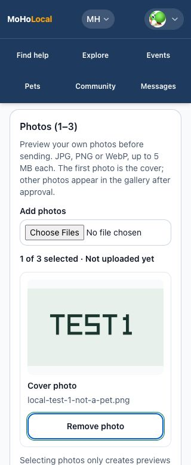

# Pet photo picker — November 16, 2026

## November 16 — local photo previews and selection recovery (PET-SHARE-04 / MOBILE-22)

IMPLEMENTED/TESTED: reporter photo picker previews1–3locally selected images before upload, labels cover/gallery, supports44px remove controls and returns keyboard focus to Add photos after removal. Additional selection appends; unsupported/empty/oversized/over-limit batches retain earlier photos with a clear error. Removing the cover promotes the remaining first photo. Object URLs are tied to File identity and released on selection change/unmount; locked requests do not claim photos remain unuploaded. Existing permission, private Storage, review, retry and withdrawal rules unchanged.

207regressions, TypeScript and OpenNext pass. Isolated320px browser test used labeled synthetic TEST images only:2decoded blob previews,44px removal/no overflow, keyboard cover removal, unsupported-file recovery and three-photo limit preserving the full set accepted. Local server logged onlyGETassets; no submission or storage upload. Sourcea216a86feba6367d0d0589e0ba4ca66e4188f71a; native/live acceptance PENDING. [Evidence](research/pet-photo-picker-2026-11-16.md).

FB UNPUBLISHED; no outreach/imports or real pet report changes. City photo tasks and genuine-reporter pilot OPEN; selecting local test images is not reporter permission or end-to-end publication acceptance. Physical-device photo selection/preparation/upload→review→gallery/withdraw and abandoned-upload retention remain OPEN.

## Scope and privacy

Photo selection creates browser blob URLs only; no remote source is fetched and no file is transmitted merely by selecting it. Upload still starts through the existing submit action after form/permission validation and normal image preparation. No backend/schema/RLS/grant changes. Photographs are not sourced from Facebook or third parties. No report was submitted, approved, imported, withdrawn or published during this task.

Invalid incoming batches are rejected as a whole without replacing earlier selected files. Files retain chosen order; no filename-based deduplication or image-matching inference. Image previews are associated with actual File objects rather than indexes so removing a cover cannot briefly associate the old preview with a new file. Blob URLs are revoked on selection changes/unmount. A preview-decode failure advises replacement; existing all-photo preparation must succeed before any upload begins. Locked request controls remain disabled by the existing form fieldset, and their status says selection locked rather than asserting no upload occurred.

## Checks

207regressions pass; new selection tests exercise nonmutating append/order, cancellation, MIME/empty/size boundaries and whole-batch rejection preserving earlier photos. TypeScript clean and OpenNext build complete after final source edits.

Isolated local browser harness bundles the actual component with generated app CSS; harness and TEST image files live only under /tmp, outside the application source/deployment. At320px width, two previews loaded from blob URLs, scroll width320px, Remove buttons44px. Keyboard removal of first image retained the second as cover and focused Add photos. Unsupported text selection preserved that cover with an alert. Adding two valid files reached3; a fourth was rejected while all3remained. Only GET requests for harness/static assets were observed in its server log, no POST/upload. Local server stopped, viewport reset. These are clearly labeled technical fixtures, not pet reports or city-photo assets.

## Production release

Native Workers Builds moho-web completed success for a216a86feba6367d0d0589e0ba4ca66e4188f71a; exact production build-info.json marker accepted. Live authenticated form at320px selected one labeled local TEST PNG. Decoded blob preview, cover label, local filename and Not uploaded yet count accepted; document scroll320px, Remove44px. Tab focused Remove, screenshot inspected. Permission unchecked and submit disabled throughout. Enter removed the fixture, count returned0, blob-image count0 and focus returned to pet-photo-files. Viewport reset and verified1274px. No report submission, storage upload, public record, Facebook import, outreach or publication. Fixture is a technical TEST tile, not an actual pet or city photo.

The genuine-reporter and physical-device pilot remains OPEN, as do2026city photo location/reuse work and abandoned-upload retention. Normal permission and editorial checks remain unchanged.

