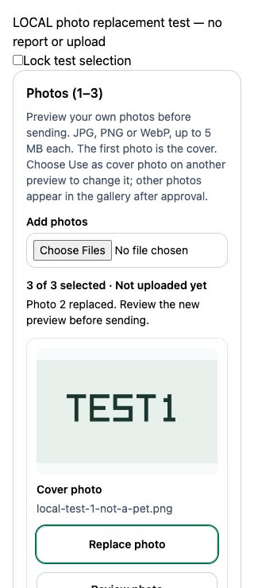
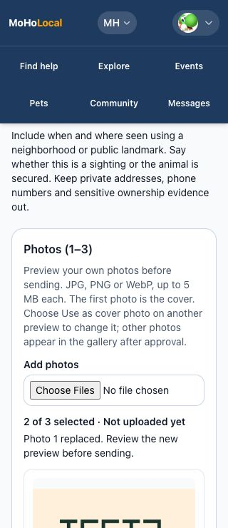

# Pet-photo replacement — November 19, 2026

PET-SHARE-13 / MOBILE-31.

## Resident improvement

Each selected photo now has a native single-file Replace photo control. A valid replacement stays in the same cover/gallery slot, including at the three-photo limit. The other File objects and their relative order remain unchanged. Validation happens before updating selection: invalid MIME/size/empty files, multiple replacements or a stale target retain the original set. Cancel/empty input is a no-op. Locked selections cannot replace. Success announces which photo changed and returns focus to the stable add-photo input; the resident can Review photo afterward.

This is local file selection only. Existing preparation/metadata removal, private upload, immutable request, publication permission and admin review stay unchanged. No storage, database, auth, access or dependency changes.

## Validation

214 regressions, TypeScript, OpenNext and CRLF-aware whitespace checks pass. New helper regression checks replacement at capacity in all slots, remaining File identity/order, unchanged input, identical filenames as distinct objects, invalid MIME/empty/oversized/multiple files, canceled input and invalid indexes.

Chrome picker automation timed out while its active window changed. Those attempts do not establish an application defect or a successful keyboard interaction. Final implementation uses a native single-file input rather than a script-clicked hidden chooser. No browser permission was expanded. The browser session reset after one uncaught chooser timeout; subsequent waits handled failures explicitly. Earlier builds were stopped and one final build completed after the final source changes.

Isolated in-app browser actual-picker harness is explicitly LOCAL and contains no database client. Three agent-created TEST PNGs (not pet or city photos) were selected through the file chooser. Space on Replace photo1 opened a single-file chooser; a valid cover replacement preserved all three slots and count. Pointer replacement of gallery photo2 also preserved the cover and other gallery photo. Unsupported text replacement showed the existing error and left all captions unchanged. Locking disabled replacement. At320×740 final controls measure44px; all previews decode and document has no horizontal overflow. No photos were uploaded or reports submitted.

## Release acceptance

Native Workers Builds moho-web succeeded for `7f722fc3306f0444200d86ae43bd1647d00f6215`; public build-info.json matched exactly. In the actual signed-in production form, two agent-created TEST images created local previews only. Space on Replace photo1 opened the native single-file chooser; selecting TEST3 replaced the cover while keeping TEST2 in its gallery slot and count at2. Focus returned to pet-photo-files, the local replacement message appeared, publication consent remained unchecked and Send stayed disabled. At320px, replacement inputs measured44px high, previews decoded, and no horizontal overflow. Saved screenshot shows TEST imagery, not a public pet report. Removed both selections, confirmed zero previews/unchecked consent and cleared device metrics; normal1879px width restored. No file upload, report save or publication occurred.

## Open work

Photo-location/date/reuse tasks, genuine-reporter send/recovery/receipt/reference-copy/review/gallery/withdraw pilot, physical-phone/screen-reader/clipboard-denial acceptance and abandoned-upload retention remain OPEN. FB UNPUBLISHED; no outreach, imports, permission requests or fabricated public records. Browser replacement tests are not genuine reporter acceptance.
