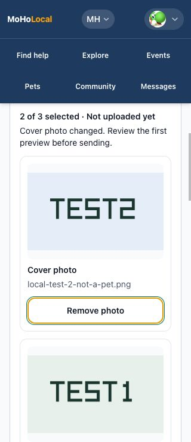
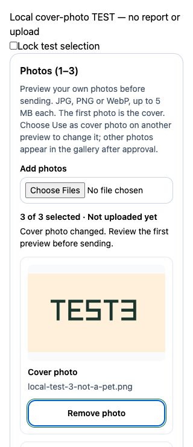

# Pet-share cover selection — November 17, 2026

PET-SHARE-07 / MOBILE-25. Application source: `0139a2ccc1942744d1b5aa5e9bb152c304557fe5`.

## Resident improvement

A reporter can choose **Use as cover photo** on any gallery preview before sending. The selected File becomes first; every other File keeps its relative order and identity. Nothing is removed or reselected. A polite status message confirms the change, and focus returns to the stable photo input. Removal also announces its result. Photo controls have explicit disabled states and handlers refuse changes when locked; the existing immutable request/upload sequence remains unchanged.

The change is local selection only. Publication consent, private pending storage and admin approval are unchanged. No Facebook fetching, posting, messages, imports, permissions, database/schema or credential changes.

## Validation

- All 213 regression tests pass. New helper coverage checks promotion, remaining order, original-array immutability, identical filenames with distinct objects, invalid indexes and empty input.
- TypeScript and final OpenNext Cloudflare build pass. Whitespace check passes with CRLF-aware settings.
- Isolated local browser harness uses the actual picker and app CSS, no database client. Three agent-created, explicitly labeled TEST images were selected through the file chooser. Keyboard Enter promoted photo 3; order became 3,1,2, count stayed three, all previews decoded, and focus returned to pet-photo-files.
- At 320px all five buttons measured 44px high; no horizontal overflow. Locking disabled the input and every photo button, with Selection locked for this request status. Unlocking restored local controls.
- These are technical fixtures, not pet reports or location photographs. Nothing was submitted or uploaded to Storage. Physical-phone and screen-reader acceptance remain open.

## Release acceptance

Native Workers Builds moho-web completed successfully for `0139a2ccc1942744d1b5aa5e9bb152c304557fe5` (build 961b87e2-69ed-4eea-b7e5-80b6654c64c9). Public `/build-info.json` matched that exact revision. On the authenticated live form, two labeled TEST files created local-only previews. Pointer activation promoted photo 2 and kept photo 1 in the gallery; count remained two, focus returned to the file input, publication consent stayed unchecked and Send remained disabled. At explicit 320px tab emulation, document width was 320px with no overflow. Photo buttons measured 44px. The browser-level viewport control did not resize this second tab; a scoped CDP device-metrics override was used and then cleared. Ordinary scroll gestures framed the screenshot. All local previews were removed afterward, with zero selected confirmed and normal width restored. No send, Storage upload or public report occurred.

## Open work

Real 2026 city-photo location/date/reuse tasks, genuine-reporter pet pilot (including actual send/recovery/review/gallery/withdraw), physical-phone/screen-reader validation and abandoned-upload retention remain OPEN. Facebook drafts remain UNPUBLISHED. No contact or imports without permission. Today's completed Tuesday freshness period is not repeated.

