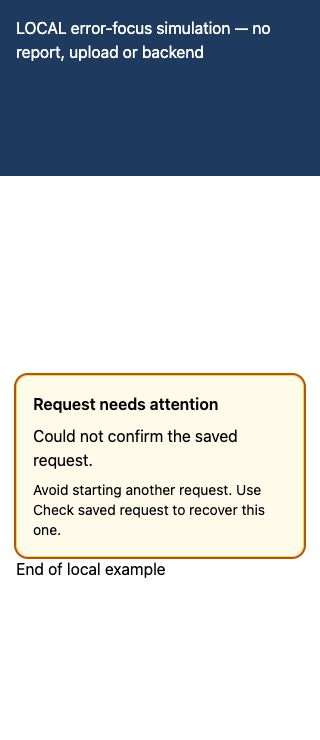
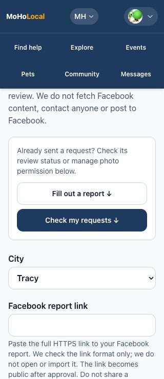

# Pet-sharing error focus — November 19, 2026

PET-SHARE-12 / MOBILE-30.

## Improvement

Submission validation, account-mismatch and preparation/upload/save/recovery errors now use a focusable Request needs attention alert. After a failed attempt, focus moves to that message so a mobile or keyboard resident can locate it in the long form. The same error on a later attempt also refocuses it using an explicit attempt counter. Existing uncertainty-specific Check saved request guidance remains separate and intact. No success, save or publication is implied by the error.

This changes presentation/focus only. Authentication, validation, submission, private upload, immutable retry, recovery and admin review behavior are unchanged. No database, dependency, access or credential changes.

## Verification

All213 regressions and TypeScript pass. Actual-component local browser harness is labeled LOCAL error-focus simulation, with no database client, uploads, reports or backend. Pointer/keyboard first validation, repeated identical validation and recovery examples focus the alert. Local draft TEST only remains unchanged. At320×740 recovery alert settles at y375–557 below a176px sticky header; at320×400 it settles at y205–387, entirely visible below that header. No horizontal overflow. Native smooth-scroll transitions were allowed to settle before acceptance; initial transient geometry is not counted. The temporary harness initially missed its stylesheet while the app build regenerated CSS; copied current CSS and reloaded before accepted checks.

## Release acceptance

OpenNext build and CRLF-aware whitespace checks pass. Native Workers Builds moho-web succeeded for `81cd9b20a9b0cdf14bad747ec247e8519be865da`; public build-info.json matched exactly. Signed-in production at320px accepts Check my requests / Back to report form round trip, correct focus targets, preserved Tracy city, no horizontal overflow, unchecked consent and disabled Send. City selection and emulation were cleared; normal1879px width confirmed. No production failure, photo upload, consent grant or report submission was created to expose the conditional error. Error focus is locally verified; real reporter failure/recovery acceptance remains OPEN.

## Open work

Photo-location/date/reuse tasks, genuine-reporter send/recovery/receipt/reference-copy/review/gallery/withdraw pilot, physical-phone/screen-reader/clipboard-denial acceptance and abandoned-upload retention remain OPEN. FB UNPUBLISHED; no outreach, imports or permission requests. Signed-in navigation acceptance from November18 remains recorded; it does not close the reporter pilot.
