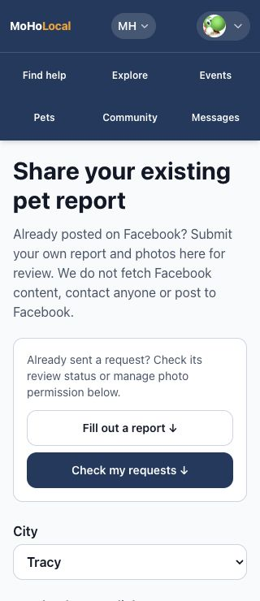
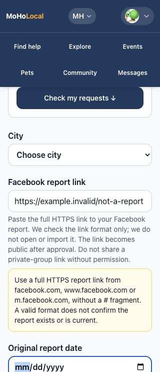

# Signed-in navigation acceptance and link entry — November 18, 2026

PET-SHARE-11 / MOBILE-29; closes authenticated navigation gate from PET-SHARE-10 / MOBILE-28 only.

## Signed-in navigation acceptance

Chrome extension access was available again. The existing authenticated production session exposed Pet sharing tasks and Your shared reports. Public marker was exactly64a4f2c4578a5da805aa7c414f4666f66bcbb10e. At320×740, keyboard Check my requests focused your-shared-reports with the expected fragment; the actual request list was empty. Pointer Back to report form focused pet-share-start and retained selected city Tracy. Keyboard Fill out a report focused pet-share-form; after scrolling settled its top was192px, below the173px navigation. Both task links measured44px high and254px wide; no horizontal overflow. Consent remained unchecked and no report or photo was submitted.

The initial CDP metrics command timed out, but read-only inspection showed it had applied320×740; no duplicate override was issued. This is desktop browser emulation, not a physical-phone or screen-reader trial.

## Mobile link-entry improvement

Facebook report link now has a concise accessible name and separate associated help. Mobile URL input mode, no auto-capitalization/correction and disabled spellcheck support pasting a link. Help explicitly asks for a full HTTPS report link and distinguishes format checking from content retrieval. A nonempty unsupported URL shows associated aria-invalid/error feedback after blur. Clearing the field removes that inline error; the existing required field and submission validator remain authoritative. Valid-looking input is never labeled verified, current, accessible or authorized. We do not open, fetch or import the link.

All213 regressions pass, including existing URL host/credentials/HTTPS/fragment checks. TypeScript, OpenNext and whitespace checks pass. In a local actual-page harness (account/empty-read mocks and blocked writes), an example.invalid test string showed the error after blur and aria-invalid=true; clearing removed both. At320px no overflow. No external link was opened and no report/photo saved. No new backend, schema, auth, permission or dependency changes.

## Release acceptance

Native Workers Builds moho-web succeeded for `ca6b129d92f9be1401cfafa4f781e874ab03d945`; public build-info.json matched exactly. Signed-in production at320px: exact accessible name Facebook report link; inputmode=url, autocapitalize=none, autocorrect=off and spellcheck=false. A nonsensitive example.invalid technical test string produced associated aria-invalid=true and the format-only error after blur. No horizontal overflow; consent unchecked. Clearing the string removed aria-invalid and the field-specific error. Repeated Check my requests / Back to report form on this revision accepted exact focus targets and preserved Tracy selection. Finally cleared the city/link entries and device override; normal1274px width confirmed. No link was opened/imported, no photo selected, and no report submitted.

## Open work

The genuine-reporter pet pilot remains OPEN: actual send/recovery/receipt/reference-copy/review/gallery/withdraw evidence is not established by empty-list navigation or local input tests. Photo-location/date/reuse tasks, physical-phone/screen-reader/clipboard-denial acceptance and abandoned-upload retention remain OPEN. FB UNPUBLISHED; no contact, imports, permission requests or fabricated public records.
