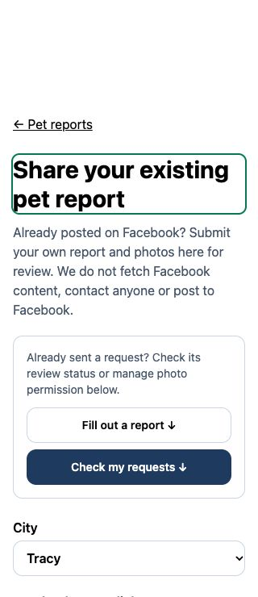
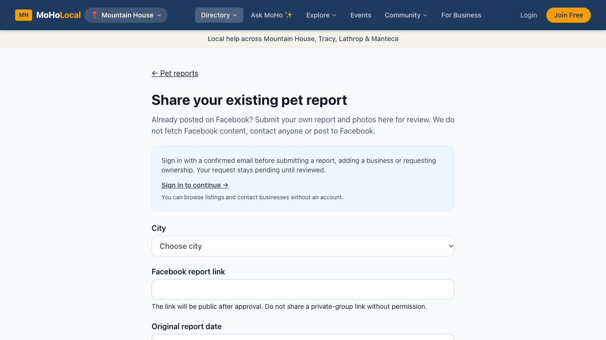

# Pet-sharing task navigation — November 18, 2026

PET-SHARE-10 / MOBILE-28. Application source `64a4f2c4578a5da805aa7c414f4666f66bcbb10e`.

## Improvement

Confirmed signed-in residents get a top-of-page Pet sharing tasks navigation: Fill out a report and Check my requests. A short explanation makes returning-request status and photo-permission management discoverable before the long form. Your shared reports gains Back to report form. Native fragment links retain form state without uploads or resubmission. The heading, form and requests region are programmatically focusable, named where appropriate and offset with scroll-margin for the mobile header. The form shortcut is omitted after a saved receipt replaces the form; the request-status shortcut remains available.

No authentication, database query, submission, recovery, permission, moderation or storage behavior changed. No social posting/contact/import added.

## Verification

All 213 regressions, TypeScript, OpenNext build and CRLF-aware whitespace checks pass. No new dependencies or static markup tests for this reversible navigation change.

Chrome extension access timed out, then became unavailable despite inventory metadata. Native Chrome showed the page, but its active tab subsequently changed; this is not treated as an authenticated acceptance or a reason to alter browser permissions. Continued in a background isolated in-app browser.

A local harness bundles the actual page and components with app CSS. Only account/Supabase boundaries are replaced in the test bundle: local simulated signed-in fixture, empty request read, and throwing write/upload stubs. No real client, credentials, photos, reports or backend writes are used. This is explicitly local simulation, not a real account or reporter. Next's client bundle required a local process.env shim; no application workaround was added.

At 320×740 the three navigation links measure 44px high, with no horizontal overflow. Keyboard Check my requests focuses your-shared-reports. Back to report form focuses pet-share-start; Tracy selection is preserved. Keyboard Fill out a report focuses pet-share-form. After native smooth scrolling settles, form/heading top is192px against a176px sticky test header; the empty requests section settles at391px due to end-of-document scroll limits and stays visible. Consent remains unchecked. First CDP sizing produced an incorrectly scaled in-app screenshot; cleared it and used the documented browser viewport override for final checks. Temporary overrides cleared afterward.

## Release acceptance

Native Workers Builds moho-web completed successfully for `64a4f2c4578a5da805aa7c414f4666f66bcbb10e`; public build-info.json matched exactly. Signed-out production page exposes the new heading/form IDs and named, focusable form, hides the account-only task navigation, retains unchecked consent and disabled Send. Production CDP responsive geometry accepted innerWidth320, innerHeight740, scrollWidth320 with no account-only navigation. Browser-level viewport calls did not affect this second tab; that call is not counted as a 320px check. Cleared CDP sizing and confirmed normal1280px width. No production report, save, upload or contact. Authenticated production round-trip navigation remains OPEN because the isolated browser is signed out and the Chrome extension was unavailable; local simulation does not close that gate.

## Open work

Photo-location/date/reuse tasks, genuine-reporter pet pilot (real send/recovery/receipt/review/gallery/withdraw), authenticated production navigation, physical-phone, screen-reader and clipboard-denial acceptance, and abandoned-upload retention remain OPEN. FB UNPUBLISHED. No outreach, imports or permission requests. No refresh rerun or artificial listing activity.
