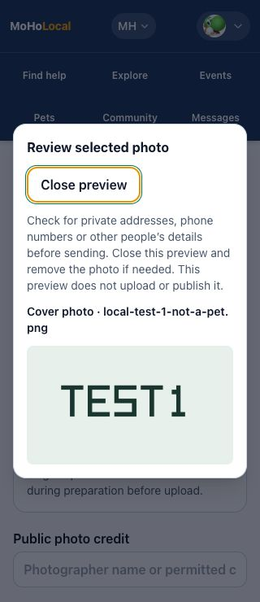

# Pet-share photo review — November 17, 2026

PET-SHARE-08 / MOBILE-26. Application source `86496d2e2dc566e1598e082559d7a0db83448cd0`.

## Change

Each readable selected photo now offers **Review photo**. A native modal dialog displays the existing local blob preview with cover/gallery label and filename. It reminds the reporter to check for private addresses, phone numbers and other people's details, then close and remove a photo if needed. It does not automatically detect or redact anything.

Opening the dialog does not prepare, upload, save, publish, import or contact anyone. Photo order and selected File objects stay unchanged. The modal is named and described, initially focuses its 44px Close preview button, supports native Escape, and returns focus to the specific review trigger after closing. A sticky close header and scrolling dialog handle short screens. Review is disabled for unreadable or not-yet-available previews and locked selections; a removed/unavailable/locked active photo closes the dialog. Private upload, permission and admin review workflows are unchanged.

## Validation

213 existing regressions pass; TypeScript and final OpenNext build pass, with CRLF-aware whitespace check. This is a reversible UI change; interaction behavior was checked in the browser rather than adding a static markup test.

An isolated local harness bundles the actual picker with app CSS and has no database client. Agent-created, explicitly labeled TEST PNGs are disposable technical fixtures, not reports or city photographs. Keyboard Enter opens the requested gallery image in a native :modal dialog and initially focuses Close preview. Escape and pointer Close return focus to their exact Review photo triggers; count and order remain unchanged. Locked selection disables review. The image source remains blob:.

At 320×740 the fresh app stylesheet gives a 288px dialog with 16px side margins and no horizontal overflow. A cached older stylesheet initially omitted the new sizing rules; updating the harness stylesheet URL fixed the test asset, with no application code workaround. At 320×400 the scrolling dialog stays within y20–380 and the 44px close button stays visible. Local tab sizing was cleared and harness tab closed. No Storage upload or report submission occurred. These desktop browser checks do not establish physical-phone or screen-reader acceptance.

## Release acceptance

Native Workers Builds moho-web completed successfully for `86496d2e2dc566e1598e082559d7a0db83448cd0`. The public build-info.json marker matched exactly. On the live authenticated form, a labeled local TEST PNG opened via keyboard in the named native modal. At 320px it measured 288px wide with 16px margins, no document overflow, and a 44px close button. The displayed image decoded from the existing blob: URL; consent remained unchecked and Send remained disabled. Escape closed the dialog and returned focus to Review photo 1. The selection was removed (zero photos confirmed), and scoped device emulation was cleared, restoring normal 1274px width. No report, upload or publication was performed.

## Open work

Photo-location/date/reuse tasks and genuine-reporter pet pilot remain OPEN, including real send/recovery/review/gallery/withdraw evidence. Physical-phone, screen-reader and abandoned-upload retention work remain OPEN. FB drafts stay UNPUBLISHED; no contact, imports or permission requests. The completed Tuesday freshness refresh is not repeated.
