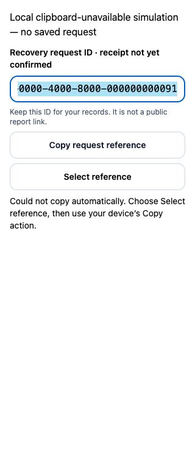
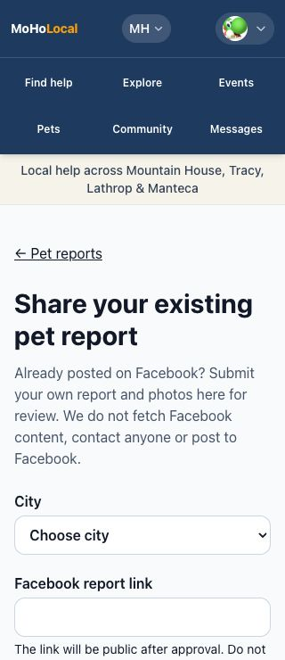

# Pet-share reference copying — November 17, 2026

PET-SHARE-09 / MOBILE-27. Application source `19b3cbe0a66cc145bc2788135891543d01cd36a9`.

## Resident improvement

Saved receipts, unconfirmed recovery IDs and Your shared reports now use the same validated request-reference control. A 44px Copy request reference button writes only the UUID; no report content, contact data, source URL or navigation parameters. A read-only, labeled, selectable field remains available. Copy feedback uses a polite atomic status region and does not claim success until the clipboard promise resolves. Unavailable/rejected clipboard writes show Select reference and device Copy instructions instead of claiming success.

The recovery label and success wording explicitly retain receipt not yet confirmed. The ID is described as a record reference, not a public report link. A keyed control resets feedback when the reference or confirmed/unconfirmed presentation changes. An immediate in-flight guard prevents overlapping copy calls. No device share menu, Facebook posting, contact or network save is added. Existing authenticated reads, permission, private uploads, admin review and request recovery remain unchanged; no database/schema/access changes.

## Validation

All 213 regressions pass, including the existing clipboard helper tests for exact payload, absent clipboard and rejected write. Existing PetShareStatus visibility/link checks continue passing. TypeScript, OpenNext and CRLF-aware whitespace checks pass. No dependency changes.

An isolated local actual-component harness is clearly labeled TEST and has no database client or saved request. At 320px, pointer copying an unconfirmed reference gives the explicit non-receipt message; switching reference/variant clears old feedback. Keyboard copying the confirmed-display example gives Request reference copied; clipboard read-back matches the exact fixture UUID. These IDs are local technical fixtures, not production reports.

A local Permissions-Policy denial attempt did not prevent clipboard writing in this connected browser; it is NOT counted as a real denied-permission acceptance. A separate, visibly labeled clipboard-unavailable simulation bundles the actual component with navigator.clipboard defined as undefined only in that local test artifact. The failure message and Select reference appear; selectionStart/End read-back confirms the full exact fixture UUID selected. Both buttons measure 44px, viewport/document width 320px, no horizontal overflow. This establishes simulated UI fallback; physical-device denial remains open.

## Release acceptance

Native Workers Builds moho-web completed successfully for `19b3cbe0a66cc145bc2788135891543d01cd36a9`; public build-info.json matched exactly. Live authenticated share form at 320px has scrollWidth 320px, unchecked consent, disabled Send, and the actual empty Your shared reports section. Temporary device emulation was cleared, restoring normal 1274px width. No files, reports, contacts or uploads were submitted. Conditional receipt/recovery/card interaction in production remains NOT ACCEPTED pending a genuine reporter request; local interaction tests establish component behavior only. No production report was fabricated to expose those states.

## Open work

Photo-location/date/reuse tasks and genuine-reporter pilot remain OPEN, including actual send/recovery/review/gallery/withdraw and the new reference control in those real states. Physical-phone, clipboard permission/availability, screen-reader and abandoned-upload retention work remain OPEN. FB stays UNPUBLISHED; no outreach, imports or permission requests. The completed Tuesday freshness refresh was not repeated.
