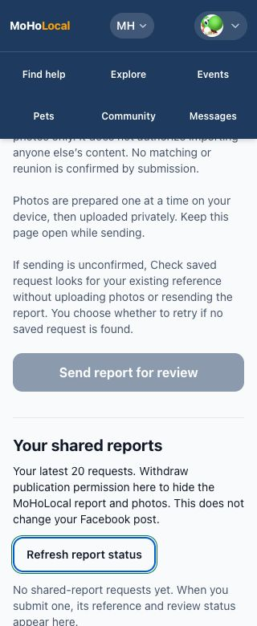

# Read-only pet-share reference recovery — November 17, 2026

## November 17 — check saved pet requests before retry (PET-SHARE-06 / MOBILE-24)

IMPLEMENTED/TESTED: an uncertain send first performs an authenticated request-ID/account-scoped read before image preparation/upload. A saved match recovers the receipt; a confirmed missing row offers a separate retry choice and checks again before retrying the same ID. Failed/malformed/wrong-reference reads stop with Nothing was resent, not a missing/success claim. Prior persistence uncertainty survives later errors. Recovery shows an explicitly unconfirmed request ID and a link to Your shared reports; account changes cannot silently resend the original request. Polite checking feedback and explanatory mobile guidance added.

212regressions, TypeScript and OpenNext pass. Helper tests cover saved/null/error/thrown/undefined/mismatched responses and invalid references; checking-progress rendering stays covered. Isolated320px actual-helper/widget simulation accepts pointer/keyboard found/missing/failure examples with no overflow; no database client, uploads or reports. Source86dab9567015e5af75c545369ca99162cb182402; native/live acceptance PENDING. [Evidence](research/pet-share-reference-recovery-2026-11-17.md).

FB UNPUBLISHED; no contact/imports, photo uploads, real report saves or publications. No schema/RLS/key/permission changes. Photo tasks and genuine-reporter pet pilot OPEN; real uncertain-send/readback/retry, physical-device and screen-reader acceptance still require genuine authorized evidence. Abandoned-upload retention remains OPEN.

## Behavior

Previously Recover this request reference re-ran preparation and private uploads before invoking the idempotent save. A request that was already stored after a lost response could therefore require unnecessary uploads or hit upload limits before recovering its saved ID.

The uncertain-send path now reads only id from pet_report_shares using the authenticated client, exact current request UUID and submitted_by account filter. Existing owner/admin RLS remains unchanged; no service key or broader access. A matching ID returns the receipt without entering the photo pipeline. The generic Request saved receipt and current-status section handle already-reviewed requests without inferring pending/public status.

Only data=null with no error is considered an empty read. Errors, undefined/array/incorrect-ID/malformed responses never mean absent. The first successful empty read offers a separate Retry this same request choice. That action reads again before any preparation/upload; if still absent it uses the original immutable ID/files. This is idempotent recovery, not a new submission. A later failure retains earlier persistence uncertainty. A request-owner ref blocks sending/recovering through a different signed-in account. An unconfirmed recovery ID is labeled accordingly; no receipt/publication claim precedes matching saved data.

The existing confirmed-account gate, publication permission, immutable upload paths, private pending photos and admin approval remain in force. No Facebook content is fetched, and no contact or imports performed.

## Verification

212tests pass, including existing real isolated PostgreSQL ownership/permission/idempotency/withdrawal/expiry checks and new read classification tests for exact saved ID, confirmed empty, returned/thrown errors, malformed/mismatched results and invalid references. TypeScript clean; OpenNext complete. The existing maybeSingle pattern was checked against [Supabase's primary reference](https://supabase.com/docs/reference/javascript/maybesingle); the changelog index showed no relevant new JS breaking change for this scoped query. No dependency upgrade.

The isolated local browser harness bundles the actual recovery helper/progress widget with app CSS; it visibly states Local recovery UI simulation and contains no database client. At320px the read-only checking description and actual failure message fit, keyboard Enter and pointer found/missing/failure examples worked, document width320px/no overflow. Fixture references exist only in local test memory; no real request/photo/upload was created. Harness stopped and viewport reset. This is not genuine reporter or phone acceptance.

## Production acceptance

Native Workers Builds moho-web completed success for86dab9567015e5af75c545369ca99162cb182402; public build-info.json exact match. Live authenticated form at320px: new read-only recovery explanation visible, scroll width320px/no overflow, consent unchecked, submit disabled/48px and aria-busy=false. Screenshot inspected; viewport restored and verified2188px. Ordinary CDP scroll gesture framed the actual new paragraph after keyboard scrolling did not frame it reliably; no DOM/content, access or other browser settings were changed. No real report save, upload, failed production request or resend was performed. In-flight recovery branches remain accepted by helper tests/local simulation, not a genuine production reporter trial.

Photo tasks, real-reporter uncertain-send/recovery/review/gallery/withdraw pilot, physical-device/screen-reader acceptance and abandoned-upload retention remain OPEN. FB UNPUBLISHED; no contact or imports.

