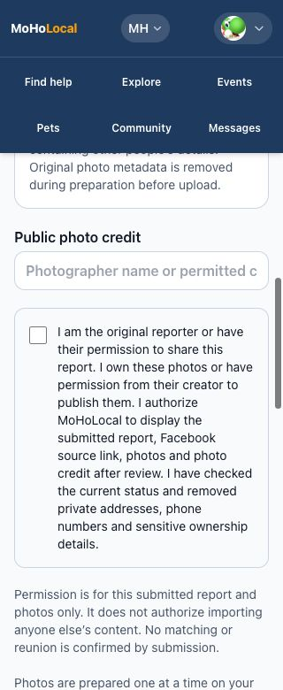

# Pet-share send stages and mobile preparation — November 16, 2026

## November 16 noon — pet-share send progress and sequential preparation (PET-SHARE-05 / MOBILE-23)

IMPLEMENTED/TESTED: mobile send action distinguishes preparing each photo, private upload of each photo and saving the request. Stable polite live region announces actual stages/counts, not estimated percentages or publication. Source images are prepared sequentially instead of concurrently; all preparation must finish before this attempt uploads anything. Failure stops remaining work with stage-specific retry wording. An immediate in-flight guard prevents overlapping submit handlers; receipt requires a UUID. Existing permission/review/private Storage/idempotency rules unchanged.

210regressions, TypeScript and OpenNext pass. Tests verify peak1concurrent preparation callback, complete prepare→lock→upload order, failure boundaries and no success/publication claims in progress. Isolated320px actual-component UI simulation accepts pointer/keyboard stages, polite status and no overflow; no files or backend requests. Memory use/performance on a physical phone is not benchmarked. Sourcea139783515626a8bb65038fd844713435b9f1177; native/live acceptance PENDING. [Evidence](research/pet-share-send-progress-2026-11-16.md).

FB UNPUBLISHED; no contact, imports, photo uploads, report saves or public records during this task. Photo-location/reuse tasks, genuine-reporter pet pilot, real-phone/photo-format/accessibility acceptance and abandoned-upload retention OPEN. Real upload/save/recovery/review/gallery/withdraw acceptance requires a genuine authorized report, not a simulation.

## Implementation

The previous single Preparing photos and saving label gave no distinction between local image work, private Storage requests and report persistence. Parallel preparation could decode several large source images at once. The domain helper now awaits one preparation callback at a time, accumulating the resized JPEG blobs; only after all prepare callbacks succeed does it lock the immutable request and start sequential private uploads. Existing image decode/resize/re-encode and bitmap-close behavior is preserved. This limits concurrent source-image preparation; no measured physical-memory or speed claim.

The same progress value drives an always-mounted polite/atomic live region and the busy submit label. Preparing/uploading stages name the current1-basedphoto count; saving starts only after all private-upload callbacks return. No invented percentage, completion time, receipt or publication is displayed. File selection stays disabled while busy and immutable after upload preparation succeeds. Error wording identifies the failed photo/stage and refers to this attempt, since an earlier retry may already have uploaded files or saved a request. An immediate ref guard prevents concurrent handler entry before React's disabled state commits. Successful RPC data must be a UUID before a receipt is shown. Unconfirmed persistence still reuses the existing request ID and recovery path.

No schema/RLS/grants, API host, public photo rules, notifications or approval behavior changed. No Facebook fetching, outreach or imports.

## Checks and limits

210tests pass: sequential preparation reaches peak1active callback; exact all-prepare-before-lock/upload order; preparation failure prevents lock/upload; upload failure stops remaining work; invalid photo counts perform no work. Rendering checks cover in-flight wording, required saved-reference explanation and absence of fake completion/publication claims. Existing privacy, owner-path, consent, admin-review, idempotency, withdrawal and expiry PostgreSQL regressions remain passing.

TypeScript clean and OpenNext complete after final edits. An isolated localhost harness bundled the actual progress component with app CSS and visibly identified itself as a UI simulation with no photos/upload/report. At320px all three stages rendered; keyboard Enter switched upload/save examples; role=status aria-live=polite and document width320px/no overflow accepted. Harness lives only under /tmp, does not import a database client or create reports, and was stopped after the check. Viewport reset. No real uploader or screen-reader/phone acceptance is inferred.

## Production release

Native Workers Builds moho-web completed success for a139783515626a8bb65038fd844713435b9f1177; public build-info.json exact source accepted. Live authenticated form at320px: new sequential preparation/private-upload guidance present; stable empty polite live region exists before sending, form aria-busy=false while idle, consent unchecked and submit disabled/48px high. Document scroll width320px/no overflow. Screenshot inspected; viewport restored and verified2188px. No photos selected, uploaded or report saved. In-flight states were verified in the labeled local UI simulation, not by submitting a fictional production report.

Photo tasks, genuine-reporter upload→save/recovery→review/gallery/withdraw pilot, physical-phone/screen-reader acceptance and abandoned-upload retention remain OPEN. FB stays unpublished; no contact or imports.

