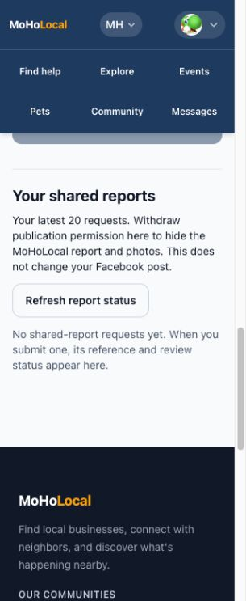

# Pet-share status recovery and mobile withdrawal — November 16, 2026

## November 16 daytime — pet-share status recovery and safer withdrawal (PET-SHARE-03 / MOBILE-21)

IMPLEMENTED/TESTED: Your shared reports now has explicit loading, fresh empty, failure and refresh states; stale cards remain visible with a warning and withdrawal is disabled until status refresh succeeds. Withdrawal requires a separate Confirm withdrawal / Keep report step, with busy feedback, keyboard focus handling and44px minimum actions. Approved records link only to a validated stored pet UUID; approval is not a claim of present visibility or reunion. Receipt now says Request saved and links to current status instead of assuming a recovered request is still pending. Account changes remount the private request list; superseded reads cannot overwrite newer state.

205regressions, TypeScript and OpenNext pass. Application source133805c0b4ded27d608492d26a9329cfa0e14d83. Native/live acceptance PENDING. No schema, RLS, permissions or publication changes. [Evidence](research/pet-share-status-recovery-2026-11-16.md).

FB UNPUBLISHED; no outreach, imports, photo uploads or real-report changes. Photo tasks and genuine-reporter pet pilot OPEN. Real-reporter save/recovery→review→gallery→withdraw and physical-device acceptance remain OPEN; no fabricated public records. Abandoned-upload retention/moderation follow-up PET-SHARE-02 remains OPEN.

## Behavior and limits

Previously the request list initially rendered no cards without loading or empty-state guidance, retained errors after a later successful read, and immediately invoked withdrawal from one button. It now labels loading separately from a successfully read empty list, catches both returned and thrown errors, offers a read-only refresh and prevents withdrawal from stale/error cards. Only the latest request generation can update state. Existing owner/admin RLS and withdrawal RPC are unchanged.

Selecting withdrawal opens inline consequence text with Confirm withdrawal and Keep report. Confirmation receives focus; cancellation returns focus to the opening control. Only confirmation invokes the existing RPC. A failed write makes no success claim and asks for status refresh before retrying. The current list is read again after a successful write; failure to read back is shown as failure to refresh rather than an empty success.

Approved links require approved status plus a UUID published_report_id. Pending, rejected, withdrawn and unknown statuses do not expose a public-report action. Approved labels explicitly defer current visibility/status to the report, since expiry or moderation can hide it. The saved receipt no longer asserts pending/not-published for a recovered reference that could have been reviewed meanwhile.

## Validation

205tests pass, including actual isolated PostgreSQL privacy/permission/withdrawal/expiry regressions and new rendering checks that prevent unapproved/invalid-ID report links or unsupported visibility/reunion claims. TypeScript clean; OpenNext complete. No data/schema/storage writes, no permission expansion and no synthetic production report. A real reporter's populated list and actual withdrawal are not claimed accepted in-browser; the existing pilot remains open.

## Production acceptance

Workers Builds moho-web completed success for133805c0b4ded27d608492d26a9329cfa0e14d83; production build-info.json exactly matches. Authenticated live320px view: pointer and Enter refresh accepted. Keyboard refresh exposed Refreshing reports / Loading your latest report status, then settled to Refresh report status and a confirmed empty request list. Refresh control44px; document scroll width305px <= viewport320px, no overflow. Permission remains unchecked and submit disabled. No error was forced in production; no real report, photo upload, approval or withdrawal performed. The actual populated confirmation/receipt journey remains open for a genuine reporter, rather than adding fake records. Screenshot inspected; viewport reset and verified2188px.

No Facebook publication, imports or contact. Photo tasks, genuine-reporter pilot, physical-device acceptance and abandoned-upload retention remain open.

