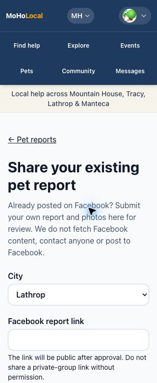

# Reporter-authorized pet sharing — November 16, 2026

## Scope

A voluntary reporter submits an existing Facebook report link, original date, current recorded status, four-city location, description, one to three photos and public photo credit at `/share-pet-report`. The app never fetches Facebook content. No outreach, Facebook publication, permission requests or imports were performed.

Permission is explicit and unchecked by default. The saved server-side version2026-11-16-v1 includes reporter authority, photographer rights, publication of the submitted report/source/photos/credit, current-status review and removal of sensitive personal details. It records the authenticated account and server time. This is a reporter assertion requiring editorial review, not independent proof of photographer ownership.

## Privacy and editorial flow

- Confirmed nonanonymous accounts only; supported cities are Mountain House, Tracy, Lathrop and Manteca.
- Photos are decoded/re-encoded to JPEG by the browser before upload, reducing dimensions to1600px and omitting original EXIF/GPS metadata. Inputs accept JPG/PNG/WebP,5MB each. This is the normal client path, not a claim that a malicious direct uploader cannot bypass client processing.
- New private Storage bucket `pet-share-pending`; owner-folder insert, confirmed identity and30photos/day upload guard. No overwrite/update permission. Save RPC verifies uploaded-object ownership, source host, date, explicit permission/version and1–3paths;10requests/day and UUID idempotency.
- Separate RLS queue `pet_report_shares`: owner/admin read; no public table access or direct client writes. Permissions and private moderation fields are not copied into public pet rows.
- Admin queue integrated into existing `/admin`, with60second signed photo previews, permission text/version/time, source/date/current status and mandatory review acknowledgement. Approve/reject is admin-only and atomically records the review. The editor must check all photos, privacy, source/date, conflicts and duplicates; no auto-approval or inferred reunion.
- Approved cover uses a same-origin image endpoint, gallery shows up to3photos with public credit and original date. Public image/media access requires an approved, visible, unexpired pet report. Images use no-store/nosniff/sandbox headers. Pending/rejected/withdrawn images remain unavailable to anonymous readers.
- Reporter withdrawal from Your shared reports hides the report and its photos. It does not delete/change Facebook posts. Requests/permission records remain for private history. Signed admin preview URLs can remain valid until their short expiry.
- Reporters retain existing pet status/progress/contact/matching controls after approval. Submission never confirms a match, owner identity or current custody.
- Save recovery reuses the same UUID and uploaded paths; details are locked after photo preparation begins so retry cannot silently attach edited text/photos to an existing request. A saved reference is shown; no automatic email or contact workflow added.

## Validation

204regressions pass, including isolated PostgreSQL transactions applying exact migration files: missing/false permission/version, missing/other-owner photos, unconfirmed identity, pending anonymous invisibility, resident approval denial, mandatory admin review, idempotent save, approved photo visibility, withdrawal and expiry hiding, anonymous/unconfirmed/other-folder upload denial. All fixture reports roll back in the disposable local database; no fictional production reports.

TypeScript clean; OpenNext build complete. Local320px browser: one main landmark, no horizontal overflow, permission unchecked, confirmed-account gate and disabled signed-out submit. No account creation, browser photo upload or actual publication was performed; genuine reporter/physical-device acceptance remains OPEN.

Production database read-back: RLS enabled; pending bucket private; anonymous submit/review execution denied; share queue0records. Security advisor returned only19existing informational private-schema deny-by-default RLS/no-policy findings; no new warning/error for this feature. Reference: https://supabase.com/docs/guides/database/database-linter?lint=0008_rls_enabled_no_policy . Storage access model consulted: https://supabase.com/docs/guides/storage/buckets/fundamentals .

## Release

Application source6df0c9c749d492642ce33dddd5f1b86bd01df4a8. Workers Builds moho-web completed success; exact public build-info.json source match. Live authenticated browser at320px: city selection Lathrop works, all text/select fields44px high, file/submit48px; permission is initially unchecked, keyboard Tab reaches it and Space toggles on/off, submit disabled when unchecked. Width/scroll320px and one main landmark; form noindex,follow. Existing admin account sees the reporter-authorized queue without load error. Pet-board entry link opens the new form. Screenshot inspected and viewport restored to1274px. No report/upload/publication/outreach performed. End-to-end real-photo acceptance remains the genuine-reporter pilot, not claimed complete.

## Open acceptance

Genuine authorized reporter trial (photo selection/preparation/upload, pending receipt, editor verification, approved gallery, progress and withdrawal) remains part of the existing pet pilot. Do not fabricate a report to close it. Physical-phone/photo-format/accessibility acceptance and operational cleanup/retention of abandoned uploads remain OPEN. Existing2026location/reuse photo tasks remain OPEN; FB drafts stay unpublished.
