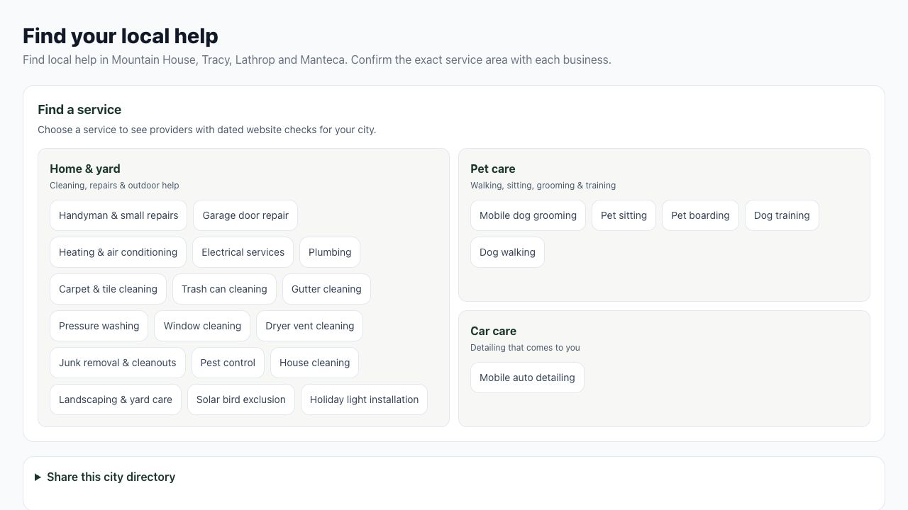

# Grouped service discovery — November 23, 2026

## Resident problem and scope
Recently published checked providers had exact tags but no dedicated shortcuts for mobile auto detailing, trash can cleaning, gutter cleaning or pressure washing. This release adds those four choices, with Home & yard, Pet care and Car care panels instead of two undifferentiated groups. Mobile keeps the disclosure closed until requested, then closes it on selection. Links retain city and exact category/service. Minimum link/button height is 44px. No images, data records, permissions or availability claims changed.

## Acceptance
- 217 regressions pass, including exact-job and category-boundary cases. Ambiguous car wash/auto repair/detailing/cleaning/gutter repair/company-name queries remain text searches.
- TypeScript and final OpenNext Cloudflare build pass.
- Local production browser: desktop panels visually accepted; at 320x740, disclosure and keyboard selection reach Lathrop mobile detailing with three checked providers and city retained.
- All 16 city/service combinations loaded, with document width equal to 320px (no horizontal overflow).

| Service | Mountain House | Tracy | Lathrop | Manteca |
| --- | --- | --- | --- | --- |
| Mobile auto detailing | 3 | 3 | 3 | 3 |
| Trash can cleaning | 1 | 3 | 3 | 3 |
| Gutter cleaning | 8 | 8 | 8 | 7 |
| Pressure washing | 3 | 5 | 5 | 5 |

Counts are existing checked directory records matching the exact job and city, not new businesses, bookings, quality, owner confirmation or current availability.

## Release
Application commit: 470d0707078afa67212cd7ca108ea5b6f81394c8.
Native build: 0bbc1c98-b158-48f2-811a-9ee817e3691a. Ready (3m24s), deployed version prefix 4dc74230. Public /build-info.json matches the full application commit. All 16 live city/service counts above match local acceptance at 320px without overflow. Lathrop mobile shortcut → Detail Guyz → Back to Lathrop results preserves Automotive/mobile-auto-detailing; phone/website actions render the checked contacts. No phone calls placed. Browser emulation, not a physical-phone test.

## Boundaries and next priority
FB remains unpublished. No contacts, imports, copied photos, fake activity or new access. Photo tasks remain open. Pet reporting remains LIVE, with ordinary moderation/QA, no pilot gate. End this UI batch after live acceptance and return to verified provider/event coverage rather than adding unrelated features.
